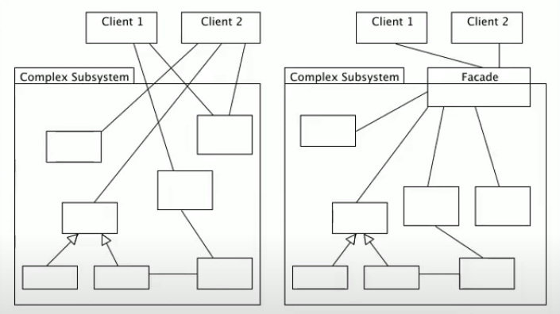

<h1 align="center">Design Patterns in Java</h1>

<p align="center">
  Clean, minimal examples of classic <b>Gang of Four</b> design patterns in <b>Java</b>,
  written for a Software Architecture course.
</p>

<p align="center"></p>

## 🧩 Patterns implemented
- **Abstract Factory** — assembling a computer from families of parts
  (`CPU`, `HD`, `SO`, `Memoria`, `Acessorios`) via factories, decoupling creation from use.
- **Facade** — `ComputerFacade` exposes a single simple entry point that hides the
  subsystem wiring needed to "start" a computer.

## 🖼️ Facade example


## 🚀 How to run
```bash
# compile and run the demo (entry point: Dominio/Main.java)
cd src
javac Dominio/Main.java -d out $(find . -name "*.java")
java -cp out Dominio.Main
```

## 📁 Project structure
```
DesignPatterns/
├── src/
│   ├── Dominio/            # Main (demo entry point)
│   ├── DominioFabrica/     # factory abstractions (Abstract Factory)
│   ├── DominioPcFabrica/   # concrete parts: CPU, HD, SO, Memoria
│   └── Facade/             # ComputerFacade
└── FacadeExample.png
```

---
<p align="center"><a href="https://www.linkedin.com/in/lucasoalima/">LinkedIn</a> &middot; <a href="https://github.com/lucasoalima">GitHub</a></p>
